 

---

### 👋 Hey, I'm Kallol

Full-stack engineer from Dhaka. I build products end to end — database schema to deploy pipeline, and the UI people actually touch.

- 🧠 **Lead Software Developer** at [Wonderscore.ai](https://wonderscore.ai) — an AI CMO / marketing-agent platform
- 🛒 **Building Softune** — a multi-tenant e-commerce SaaS that lets Bangladeshi merchants launch their own store
- 🤝 Open to freelance work and collaborations — web apps, SaaS, mobile

### 🛠️ Stack

   
   
   
   
  

### 🚧 Currently

| | |
|---|---|
| **Softune** | Multi-tenant storefront builder — tenant dashboards, custom domains, local payments |
| **Wonderscore.ai** | Leading development of AI marketing agents |
| **Learning** | System design at scale, AI agent architecture |

Ship it, measure it, make it better.

